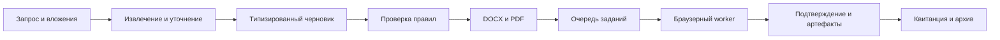

# Buscript · автоматизация уведомлений об организованной перевозке детей

**Портфельный кейс:** от разрозненных скриптов подготовки документов и заполнения портала ГИБДД к многопользовательскому приложению с проверяемым процессом подачи.

> Репозиторий содержит обезличенную копию кода. Все примеры синтетические; реальные заявки, данные детей и родителей, контакты клиентов, ключи, токены и результаты подачи не публикуются.

## Задача

Одно уведомление собирает сведения о заказчике, перевозчике, автобусах, водителях, детях, сопровождающих и маршруте. Ручной перенос этих данных между запросом клиента, документом и веб-формой отнимает время и повышает риск расхождений. Я построил процесс, в котором данные проходят через типизированную модель, проверку, генерацию документов и контролируемое заполнение портала.

## Что реализовано

| Слой | Логика |
| --- | --- |
| Подготовка | Из текста и вложений создаётся черновик поездки; недостающие сведения возвращаются на уточнение. |
| Проверка | Правила валидируют состав поездки, маршрут, транспорт и обязательные поля до подачи. |
| Документы | Из шаблона формируются DOCX и PDF; подпись и печать берутся из профиля конкретной компании. |
| Подача | Browser worker заполняет портал, сохраняет доказательства и в безопасном режиме останавливается до финальной отправки. |
| Контроль | Фоновые задания, статусы, архив файлов, аудит и разграничение данных между компаниями. |



## Два поколения кода

- **`legacy/`** — обезличенные модули исходной автоматизации: сборка DOCX через OOXML, заполнение многошаговой формы Playwright и последовательная обработка JSON payload через CDP. Финальная отправка в batch остаётся ручным действием.
- **`apps/`** — Buscript: Next.js интерфейс, FastAPI, PostgreSQL, Redis/Celery, browser worker, генерация документов и тесты. Данные компаний изолированы по tenant ID. Подача в продакшн включается отдельным флагом; локальный режим по умолчанию останавливается на странице подтверждения.

[Разбор архитектуры и решений](docs/portfolio-architecture.md) · [Локальный запуск](docs/development.md)

## Технологии

Python, FastAPI, SQLAlchemy, Celery, PostgreSQL, Redis, Playwright, Next.js, TypeScript, Docker Compose, OOXML, LibreOffice. LLM провайдер используется для извлечения данных из документов; его ответ проходит валидацию и не является основанием для автоматической отправки.

## Быстрый старт

```bash
cp .env.example .env
# Задайте свои секреты и ключ LLM в .env.
docker compose up --build
```

Интерфейс: `http://localhost:3100`. Для локальной проверки без LLM можно выставить `LLM_PROVIDER=mock` при `APP_ENV=development`. Значение `GIBDD_LIVE_SUBMISSION=false` оставляет финальное действие недоступным. Этот режим позволяет изучить поток без отправки уведомления.

## Проверка кода

```bash
# Если зависимости уже установлены:
cd apps/api && pytest
cd ../.. && npm test && npm run lint
node --check legacy/gibdd_autofill_node.js
node --check legacy/gibdd_autofill_chrome_batch.js
```

Тесты API покрывают извлечение, бизнес-правила, создание документов, изоляцию данных, процесс подачи и обработку результатов. Реальные документы и портал в тестовые фикстуры не входят.

## Статус

Это инженерный кейс и локально запускаемый прототип приложения. Исторические скрипты показывают путь развития системы, а не готовый автономный сервис для сторонних пользователей. Доступность внешнего портала, CAPTCHA, сетевой маршрут и финальное подтверждение зависят от среды и требуют отдельной проверки перед рабочим использованием.

## Безопасность публикации

Сборка создана отдельно от рабочего каталога. В репозитории нет реальных payload, PDF/DOCX заявок, квитанций, `.env`, клиентских справочников или сохранённых сессий браузера. Вместо справочников по умолчанию используются пустые массивы. Перед любым будущим коммитом нужно повторять проверку файлов на персональные данные и секреты.
